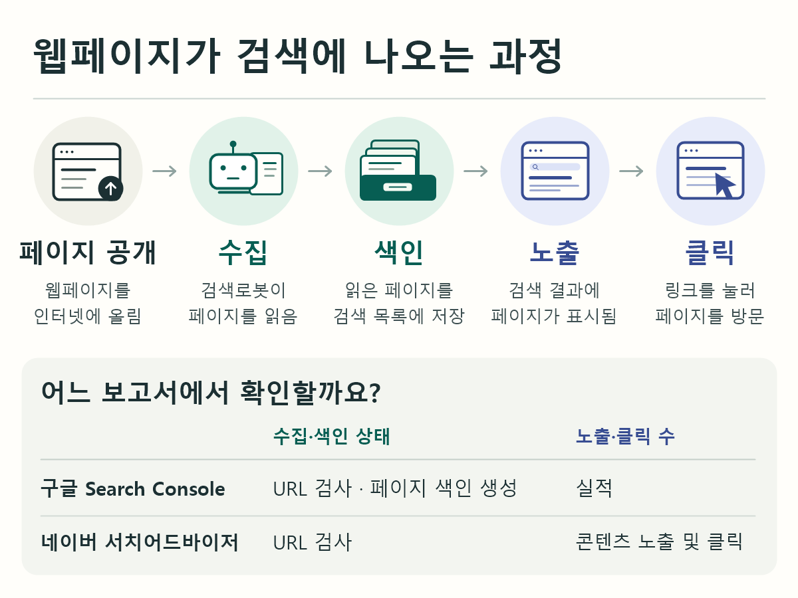

# 처음 만든 웹사이트를 구글과 네이버에서 운영하는 법

공방 홈페이지를 처음 맡았다고 생각해 보자. ‘도예 수업 예약 취소 안내’를 발행했고 링크를 보내면 친구는 읽을 수 있다. 이제 할 일은 **검색엔진도 그 페이지를 읽었는지**, **어떤 질문에 그 페이지를 보여 주는지** 확인하는 것이다. 아래 실습은 직접 운영하는 독립 웹사이트 기준이다. 본문 속 `example.com`은 설명용 주소이므로 실제 사이트에서 복사한 주소를 사용한다.

그림을 글로 읽으면 **공개 → 수집 → 색인 → 노출 → 클릭**이다. 공개는 다른 사람이 주소를 열 수 있는 상태, 수집은 검색로봇이 페이지를 가져가는 일, 색인은 검색엔진이 내용을 정리해 검색 후보로 보관하는 일이다. 노출은 결과에 뜬 횟수, 클릭은 방문자가 그 결과를 누른 횟수다. 한 단계가 끝났다고 다음 단계가 보장되지는 않는다. [구글 Search Console 소개](https://support.google.com/webmasters/answer/9128668?hl=ko) · [네이버 검색엔진 최적화 기초](https://searchadvisor.naver.com/guide/seo-basic-intro)

처음 발행하는 사이트라면 **1~3절**을 따라 공개한 주소 한 개를 두 도구에서 검사한다. 이미 공개한 페이지가 검색에 보이지 않으면 **4절**에서 현재 보이는 증상을 찾는다. 색인은 됐는데 노출이나 클릭이 줄었다면 **5절**에서 보고서의 기간과 집계 범위를 먼저 맞춘다.

## 1. 사이트와 페이지를 공개한다

1. **사이트를 만들 자리를 정한다.** 처음이라면 글을 편집하고 ‘게시’를 누를 수 있는 웹사이트 제작 서비스나 CMS(콘텐츠 관리 시스템)로 시작할 수 있다. 도메인은 인터넷 주소의 이름, 호스팅은 페이지를 인터넷에 내보내는 서비스다. 제작 도구가 둘을 함께 관리하기도 한다. 이미 운영 중인 사이트라면 그 사이트의 편집 권한과 주소부터 확인한다.
2. **홈페이지와 상세페이지 하나를 만든다.** 홈페이지에는 누구의 사이트인지, 무엇을 찾을 수 있는지 쓰고 ‘도예 수업 예약 취소 안내’ 같은 메뉴나 링크를 단다. 상세페이지에는 독자의 질문에 답하는 제목과 본문을 넣는다. 취소 기한이 있다면 본문에서 읽을 수 있어야 한다. 이미지 한 장에만 적어 두면 글자를 복사하거나 음성으로 읽기 어렵다. [네이버 · 웹 사이트를 만들 때](https://searchadvisor.naver.com/guide/seo-basic-create)
3. **미리보기와 실제 주소를 구분한다.** 게시한 뒤 로그아웃한 창에서 홈을 열고 링크를 눌러 상세페이지까지 가 본다. 주소창의 최종 `https://…` 주소를 복사한다. 예를 들어 홈페이지는 `https://example.com/`, 상세페이지는 `https://example.com/classes/cancellation`이다. 관리자 편집 주소와 방문자가 읽는 주소를 혼동하면 이후 검사 결과도 엉뚱해진다.

홈페이지와 상세페이지의 공개 주소를 기록한다. 문구를 고치려면 사이트 편집 권한이 필요하다. 이미 연결된 검색 도구에서 실적만 읽는 담당자는 사이트 설정을 바꿀 필요가 없다. [한국어 웹 문구 지침](한국어-웹문구-작성지침.md) · [검색 제목·메타태그 지침](검색-메타태그-작성지침.md)

**홈에서 누를 수 있는데도 검색로봇이 상세 주소를 놓칠 수 있다.** 공방 홈의 ‘취소 안내’가 스크립트로 화면만 바꾸면 사람은 안내를 읽어도 로봇이 따라갈 주소가 없을 수 있다. 제작 도구에서 링크 대상에 실제 상세페이지 URL을 지정한다. 직접 HTML을 쓰면 `<a href="/classes/cancellation">도예 수업 취소 안내</a>`처럼 쓴다. 게시 후 링크 주소를 복사해 새 창에서 같은 안내가 열리는지 본다. 그다음 양쪽 URL 검사로 수집 상태를 확인한다. [구글의 크롤링 가능한 링크](https://developers.google.com/search/docs/crawling-indexing/links-crawlable?hl=ko) · [네이버의 링크 관리](https://searchadvisor.naver.com/guide/resource-and-link)

**휴대폰에서도 같은 답을 읽을 수 있는지 본다.** PC에는 ‘전날 오후 6시까지’가 있지만 모바일에서는 ‘취소 가능’만 보인다면, 모바일 페이지에 빠진 기한을 복원한다. 구글은 스마트폰용으로 수집한 내용을 색인에 사용한다. 화면을 간결하게 하려고 접어 둔 설명은 그대로 둘 수 있다. 다만 누른 뒤에야 서버에서 본문을 가져오는 구현이라면, 사람이 누르기 전에도 로봇이 주요 내용을 읽을 수 있도록 제작자에게 확인한다. [구글의 모바일 중심 색인 안내](https://developers.google.com/search/docs/crawling-indexing/mobile/mobile-sites-mobile-first-indexing?hl=ko)

## 2. 내 사이트를 두 도구에 연결한다

구글이나 네이버 계정으로 해당 도구를 연다. 구글 속성이 이미 있다면 소유자가 **설정 → 사용자 및 권한**에서 담당자를 초대할 수 있다. 제한된 권한으로도 실적은 볼 수 있다. 사이트 편집, DNS 관리, 검색 도구 이용 권한은 각각 따로 확인한다. [구글 · 사용자별 권한](https://support.google.com/webmasters/answer/7687615?hl=ko) · [구글 Search Console 열기](https://search.google.com/search-console/) · [네이버 웹마스터 도구 열기](https://searchadvisor.naver.com/console/board)

두 서비스 모두 검색로봇이 공개 웹을 스스로 발견할 수 있다. 소유 확인을 하면 운영자가 해당 사이트의 보고서를 읽고 문제를 조사할 수 있다. 소유 확인 태그를 넣었다고 검색 순위가 오르지는 않는다. [구글 · 속성 추가](https://support.google.com/webmasters/answer/34592?hl=ko) · [네이버 · 사이트 등록 및 소유확인](https://searchadvisor.naver.com/guide/faq-start-register)

| 할 일 | 구글 Search Console | 네이버 서치어드바이저 |
|---|---|---|
| 관리할 사이트 선택 | **속성 추가**를 연다. ‘속성’은 이 계정에서 살펴볼 주소 범위다. 도메인 속성 `example.com`은 하위 도메인과 http·https를 포함한다. 이 실습처럼 홈페이지와 상세페이지를 함께 검사하려면 URL 접두사에 `https://example.com/`처럼 실제 홈 주소를 넣는다. `/classes/`까지 넣으면 그 경로 아래 페이지만 포함된다. | 로그인한 뒤 **웹마스터 도구 → 사이트 등록**에 사이트의 대표 주소를 적는다. 방문자가 쓰는 `https`와 `www` 유무를 확인한다. |
| 내가 관리자임을 증명 | 도메인 속성은 DNS 인증을 쓴다. 도메인 관리 화면에서 구글이 안내하는 DNS 레코드를 추가한다. DNS 권한이 없고 홈페이지를 편집할 수 있다면 URL 접두사 속성을 선택해 화면에서 제공하는 HTML 태그 등 가능한 방식을 사용한다. | 홈페이지 원본 HTML의 `<head>`에 네이버가 발급한 태그를 넣거나 제공된 HTML 파일을 안내한 위치에 올린다. 태그를 쓰는 경우 제작 도구에 ‘사이트 소유 확인’ 입력란이 있는지 확인한다. |
| 완료를 확인 | 인증 후 선택한 속성의 주소가 내 사이트와 일치하는지 본다. URL 접두사 방식에서는 `https`와 `http`, `www`가 있는 주소와 없는 주소가 구별된다. | 인증 후 사이트 목록에서 내 주소를 선택해 보고서를 연다. 인증이 실패하면 브라우저 ‘페이지 소스 보기’에서 홈페이지의 `<head>`에 값이 들어갔는지 확인한다. 자바스크립트가 나중에 추가한 태그는 네이버 소유 확인에 쓸 수 없다. |

인증 정보는 사이트에 유지한다. 플랫폼이 DNS나 HTML 편집을 제공하지 않으면 기존 소유자에게 권한을 받거나 제작 서비스가 지원하는 연결 방식을 확인한다. 사이트 관리자가 아닌 방문자가 임의의 주소를 인증할 수는 없다. [구글 · 도메인과 URL 접두사](https://support.google.com/webmasters/answer/34592?hl=ko) · [구글 · 소유권 확인](https://support.google.com/webmasters/answer/9008080?hl=ko) · [네이버 · 소유확인 방식과 실패 사례](https://searchadvisor.naver.com/guide/faq-start-register)

## 3. 검색로봇이 글을 찾고 읽을 수 있게 한다

**먼저 내부 링크를 본다.** 메뉴에서 상세페이지로 이동할 수 있는지, 링크 주소가 공개 주소인지 확인한다. 네이버에서 등록 전 홈페이지 상태만 간단히 살펴볼 때는 ‘사이트 간단 체크’를 쓸 수 있다. 로그인이 필요할 수 있다. 상세페이지 한 건의 수집·색인 이력은 소유 확인 후 ‘URL 검사’에서 본다. [네이버 · 사이트 간단 체크](https://searchadvisor.naver.com/guide/diagnose-site) · [네이버 · URL 검사](https://searchadvisor.naver.com/guide/url-inspection)

**다음으로 사이트맵을 찾는다.** 사이트맵은 검색에 알리고 싶은 페이지 주소를 모아 둔 파일이다. 제작 도구가 자동 생성하는 경우가 있으므로 관리자 화면이나 도움말에서 주소를 복사하고 브라우저로 열어 본다. 이름이 꼭 `/sitemap.xml`인 것은 아니다. 구글의 **Sitemaps(사이트맵)** 및 네이버의 **요청 → 사이트맵 제출**에 그 주소를 입력한다. 두 도구에 파일을 새로 업로드하는 과정은 없다. 구글의 ‘성공’은 사이트맵을 읽었다는 뜻이다. 네이버에 RSS도 제출할 때에는 실제 발행 글이 있고 내 사이트 주소를 담은 피드를 쓴다. [구글 · 사이트맵 제출과 상태](https://support.google.com/webmasters/answer/7451001?hl=ko) · [네이버 · RSS 및 사이트맵 제출](https://searchadvisor.naver.com/guide/request-feed)

구글에서 제출 버튼을 쓸 수 없다면 선택한 속성과 내 권한을 먼저 확인한다. 구글의 권한표에는 소유자와 전체 권한 사용자가 제출할 수 있다고 표시되지만, 사이트맵 도움말은 소유자 권한을 안내한다. 버튼이 활성화되어 있으면 그대로 제출하고, 권한 때문에 막히면 기존 소유자에게 사이트맵 주소를 보내 제출을 맡긴다. [구글 · 권한표](https://support.google.com/webmasters/answer/7687615?hl=ko) · [구글 · 사이트맵 제출 절차](https://support.google.com/webmasters/answer/7451001?hl=ko)

**대표 페이지 하나로 결과를 읽는다.** 그 페이지를 처음 발행했거나 중요한 수정을 했을 때 아래 두 검사를 해 본다.

| 확인할 것 | 구글에서 할 일 | 네이버에서 할 일 |
|---|---|---|
| 검색엔진에 저장된 상태 | 상단 **URL 검사**에 상세페이지 주소를 붙인다. 색인 상태와 마지막 크롤링 날짜를 읽는다. 구글이 선택한 대표 URL은 색인된 버전의 정보에서 확인한다. | 등록한 사이트의 **URL 검사**에 같은 주소를 넣는다. 서버 응답, 수집 여부, 색인 가능 여부, 실제 색인 여부를 각각 읽는다. 데이터가 있는 항목만 표시되므로 표가 안 보이면 ‘자료 없음’으로 기록한다. |
| 방금 수정한 내용 | **실제 URL 테스트 → 테스트된 페이지 보기**에서 현재 가져온 화면이나 HTML을 본다. 고친 본문이 보이면 재수집을 요청할 수 있다. 실제 색인이나 대표 URL 변경 여부는 다음 크롤링 후 저장된 상태에서 확인한다. | 수정한 페이지의 수집이 필요하면 **요청 → 웹 페이지 수집**에 넣는다. 요청을 접수했어도 실제 수집과 색인까지 끝났다는 뜻은 아니다. 이후 같은 주소를 URL 검사에서 확인한다. |
| 여러 페이지에 같은 문제가 있을 때 | **페이지 색인 생성** 보고서에서 같은 사유로 묶인 주소 중 하나를 골라 검사한다. 중복 주소나 의도적으로 비공개인 페이지가 제외된 데에는 조치가 필요 없을 수 있다. | **리포트 → 사이트 진단**에서 수집제한과 색인제외를 구별한다. 최근 수집분을 분석하는 보고서이므로 방금 고친 결과가 바로 보이지 않을 수 있다. |

검사 결과에는 **무엇이 잘못됐는지와 마지막으로 언제 읽혔는지**가 함께 중요하다. CMS에서 수정을 저장한 시각과 비교해 이전 버전의 문제인지 확인한다. [구글 · URL 검사](https://support.google.com/webmasters/answer/9012289?hl=ko) · [구글 · 페이지 색인 생성](https://support.google.com/webmasters/answer/7440203?hl=ko) · [네이버 · 수집요청](https://searchadvisor.naver.com/guide/request-crawl) · [네이버 · 사이트 진단](https://searchadvisor.naver.com/guide/report-diagnosis)

## 4. 검색에 보이지 않을 때 첫 번째로 열 화면

| 지금 보이는 현상 | 먼저 확인 | 결과에 따른 다음 행동 |
|---|---|---|
| 방문자도 주소를 열 수 없다 | 로그아웃한 창에서 정확한 주소를 연다. 로그인 요구, 없는 페이지(404), 서버 오류 여부를 본다. | 공개 안내문이라면 게시 상태·주소·서버 문제부터 해결한다. 회원 전용 페이지라면 비공개 의도를 유지한다. |
| 방문자는 보는데 검색로봇이 못 읽는다 | 양쪽 **URL 검사**에서 접근 오류를 본다. `robots.txt`는 로봇이 어느 경로를 수집할 수 있는지 알려 주는 파일이다. | 제작 도구의 전체 사이트 검색 차단, 로그인 요구, 서버 접근 제한 중 무엇이 원인인지 확인한다. 공개할 주소를 바로잡은 뒤 다시 검사한다. [네이버 · robots.txt](https://searchadvisor.naver.com/guide/seo-basic-robots) |
| 접속은 성공했는데 본문이 비어 있다 | 브라우저에는 취소 기한이 보이는데 구글 **실제 URL 테스트 → 테스트된 페이지 보기**에는 ‘불러오는 중’만 남았는지 살핀다. 네이버의 URL 검사에서는 서버 응답과 실제 색인 여부를 확인한다. | 정상 응답(200)이어도 본문을 불러오는 데 실패할 수 있다. 제작 담당자에게 주소와 검사 화면을 보내고, 수정 후 같은 검사에서 기한 문장이 보이는지 확인한다. 삭제한 주소가 200으로 ‘없는 페이지’만 보여 주면 **소프트 404**일 수 있다. 대체 페이지가 없는 영구 삭제라면 실제 404 또는 410 응답을 확인한다. [구글 · HTTP 상태 코드](https://developers.google.com/crawling/docs/troubleshooting/http-status-codes?hl=ko) · [네이버 · 자바스크립트 처리](https://searchadvisor.naver.com/guide/seo-advanced-javascript) · [네이버 · 소프트 404](https://searchadvisor.naver.com/guide/seo-advanced-indexing) |
| 수집했는데 색인에서 제외됐다 | 페이지에 검색 제외 지시인 `noindex`가 있는지, 같은 내용의 다른 주소가 대표로 선택됐는지 본다. | 공개할 대표 주소라면 잘못된 제외 설정이나 내부 링크를 고친다. 대표 페이지가 이미 색인된 경우라면 복사본까지 색인시킬 필요는 없다. [구글 · 색인 제외](https://developers.google.com/search/docs/crawling-indexing/block-indexing?hl=ko) · [네이버 · 선호 URL과 로봇 메타태그](https://searchadvisor.naver.com/guide/markup-structure) |
| 색인됐는데 내 검색어로 안 보인다 | 구글 **실적**에서 해당 페이지를 필터링해 검색어를 본다. 네이버 **콘텐츠 노출 및 클릭**에서는 기간별로 클릭이 많은 검색어 목록과 URL 목록을 각각 확인한다. 두 목록의 같은 순번이 한 쌍이라고 단정하지 않는다. | 방문자가 묻는 질문과 본문의 답을 맞춰 본다. 검색어 한 번을 직접 입력해 본 결과만으로 사이트 전체가 누락됐다고 판단하지 않는다. [구글 · 실적 보고서](https://support.google.com/webmasters/answer/7576553?hl=ko) · [네이버 · 콘텐츠 노출 및 클릭](https://searchadvisor.naver.com/guide/report-expose-ctr) |
| 예전 제목이나 다른 설명이 뜬다 | 실제 페이지의 검색 제목·대표 제목·본문과 마지막 수집 시점을 비교한다. | 값이 잘못됐으면 원본부터 수정한다. 재수집 후에도 검색엔진은 검색어에 맞는 설명을 본문에서 고를 수 있다. [구글 · 스니펫](https://developers.google.com/search/docs/appearance/snippet?hl=ko) · [네이버 · 노출 제목·설명문 갱신](https://searchadvisor.naver.com/guide/faq-serpedit) |

**예약 내역이 검색에 보이면** 먼저 로그아웃하고 그 주소를 열어 본다. 고객 이름이나 연락처가 그대로 보이면 즉시 원본을 비공개로 전환하고 접근 권한을 고친다. 이후 로그아웃 상태와 권한이 없는 점검용 회원 계정에서 해당 예약을 열 수 없는지 확인한다. `robots.txt`는 수집을 조절하고 `noindex`는 로봇이 읽은 페이지를 검색에서 제외한다. 둘 다 주소를 아는 사람의 열람을 막아 주지는 않는다. 누구나 읽어도 되지만 검색에서만 빼고 싶은 공지라면 로봇이 읽을 수 있게 두고 `noindex`를 적용한다. [구글 · 사이트 정보 삭제와 비밀번호 보호](https://developers.google.com/search/docs/crawling-indexing/remove-information?hl=ko) · [구글 · noindex가 적용되는 조건](https://developers.google.com/search/docs/crawling-indexing/block-indexing?hl=ko)

## 5. 방문자가 무엇을 찾았는지 읽는다

**예시.** 지난 4주간 구글에서 취소 안내 페이지의 노출이 1,000회이고 클릭이 30회라면 클릭률은 3%다. Search Console은 검색 결과의 링크를 누른 횟수를 센다. 방문한 뒤의 활동은 애널리틱스에서 세션으로 묶으므로 두 숫자는 달라질 수 있다. 예약 성과를 보려면 예약 완료 기록이나 실제 완료 시점에 측정하도록 설정한 이벤트를 확인한다. [구글 · 실적 보고서 읽기](https://support.google.com/webmasters/answer/7576553?hl=ko) · [구글 · Search Console과 애널리틱스의 측정 차이](https://developers.google.com/search/docs/monitor-debug/google-analytics-search-console?hl=ko)

- **구글에서** 같은 페이지와 검색 유형을 선택하고 검색어·기기별로 비교한다. 평균 게재순위는 해당 조건에서 내 사이트의 가장 위쪽 결과가 차지한 순위의 평균이다. 익명 처리된 검색어는 표에서 빠질 수 있으므로 검색어별 클릭수를 더해도 차트 총계와 다를 수 있다. 최신 점선 구간은 아직 변할 수 있다. [구글 · 실적 집계](https://support.google.com/webmasters/answer/7576553?hl=ko) · [구글 · 검색어 생략과 대표 URL](https://support.google.com/webmasters/answer/17011259?hl=ko)
- **구글 AI 개요·AI 모드에서** 내 사이트 링크가 표시된 횟수는 **생성형 AI 실적 보고서**에서 본다. 일반 웹 검색 실적에도 포함되는 값이므로 두 보고서의 노출수를 더하지 않는다. 노출이 부족해 보고서가 열리지 않는 경우도 있다. [구글 · 생성형 AI 실적 보고서](https://support.google.com/webmasters/answer/16984139?hl=ko)
- **네이버에서** **콘텐츠 노출 및 클릭**의 ‘최근 업데이트’ 날짜를 먼저 확인한다. 공식 안내상 약 1주 전 검색 데이터를 기준으로 최근 90일을 제공한다. ‘최근 7일’을 눌렀다면 화면에 표시된 시작일과 종료일을 기록한다. 웹 검색 관련 영역을 집계하고 블로그 검색 영역과 검색 광고는 제외한다. 검색어와 문서 목록은 각각 클릭수 상위 30건이라 목록 밖의 주소도 노출됐을 수 있다. [네이버 · 집계 범위와 기간](https://searchadvisor.naver.com/guide/report-expose-ctr)

**제목을 고친 뒤 판단하는 예** — ‘이용 안내’를 ‘도예 수업 예약 취소 안내’로 바꿨다면 수정일과 재수집일을 기록한다. 재수집 뒤 보고서에 데이터가 쌓이면 같은 페이지·검색어·기기에서 같은 요일 구성이 되도록 두 기간을 비교한다. 노출은 비슷한데 클릭률이 올랐다면 ‘관찰 기간에 더 자주 선택됐다’고 적을 수 있다. 이전 연도 기록이 있는 사이트는 조회 기간을 최대 16개월로 넓혀, 작년 같은 신청 시즌에도 비슷한 변화가 있었는지 살핀다. 게재순위까지 크게 달라졌다면 제목만의 효과를 판별하기 어렵다. 데이터가 적으면 다음 점검까지 판단을 미룬다. [구글 · 검색 트래픽 변화 진단](https://developers.google.com/search/docs/monitor-debug/debugging-search-traffic-drops?hl=ko)

**여러 페이지의 지표가 같은 날 갑자기 줄었다면** 보고서의 집계 변경 공지도 확인한다. 네이버는 2026년 10월 지표부터 시스템 이전으로 사이트 진단의 색인·제외 수치와 노출·클릭 수치가 일부 달라질 수 있다고 안내했다. 구글은 같은 해 11월 9~11일 생성형 AI 노출수가 기록 오류로 낮게 집계됐다고 밝혔다. 이런 날짜가 겹치면 해당 기간에 표시해 두고, 그 그래프 하나만 보고 페이지를 다시 쓰지 않는다. [네이버 · 리포트 통계 변경 공지](https://blog.naver.com/naver_webmaster/224456824688) · [구글 · 데이터 이상 기록](https://support.google.com/webmasters/answer/6211453?hl=ko)

## 6. 발행한 글을 고치거나 옮길 때

| 운영 상황 | 처리 순서 |
|---|---|
| 같은 수업의 취소 기한이 바뀜 | 기존 주소의 본문과 검색 설명에서 기한을 함께 고친다. 날짜가 있는 공지는 어떤 예약부터 적용되는지 밝힌다. 게시 후 실제 주소에서 바뀐 기한을 읽어 보고, 필요하면 두 엔진에 재수집을 요청한다. |
| 같은 안내가 새 주소로 영구 이동 | 예전 링크로 들어온 사람도 새 안내에 도착하도록 CMS의 ‘영구 리디렉션(301)’에 이전 주소와 새 주소를 대응시킨다. 메뉴와 사이트맵도 새 주소로 바꾸고 양쪽 URL을 확인한다. [구글 · 리디렉션](https://developers.google.com/search/docs/crawling-indexing/301-redirects?hl=ko) · [네이버 · 웹 페이지의 이동](https://searchadvisor.naver.com/guide/seo-basic-redirect) |
| 안내를 내렸는데 검색에 계속 보임 | 영구 삭제한 페이지는 없는 주소라는 응답(예: 404)을 보내는지 점검한다. 회원만 보게 한 자료는 실제 로그인 권한을 적용한다. 구글 삭제 도구로 숨기는 조치는 일시적이므로 원본도 목적에 맞게 처리한다. 네이버도 원본을 조치한 뒤 검색 제외 요청을 할 수 있다. [구글 · 삭제 도구](https://support.google.com/webmasters/answer/9689846?hl=ko) · [네이버 · 웹 검색 제외](https://searchadvisor.naver.com/guide/faq-serpremove) |

## 7. 내 사이트에서 해 보는 마무리 실습

| 적어 볼 항목 | 기록 예시 |
|---|---|
| 검색에 내보낼 실제 페이지와 방문자의 질문 | 도예 수업 취소 안내 · “언제까지 무료인가요?” |
| 링크와 본문 | 홈 메뉴에서 열림 · 본문 첫 문장에 무료 취소 기한 표시 |
| 구글 검사 결과 / 확인한 날짜 | 실제 도구에서 읽은 ‘저장된 색인 상태’와 ‘실제 URL 테스트 결과’를 따로 적기 |
| 네이버 검사 결과 / 확인한 날짜 | 같은 주소의 ‘수집 여부’와 ‘색인 여부’를 따로 적기 |
| 다음에 할 일 하나 | 예를 들어 수집이 막혔다면 접근 문제를 고치고, 이미 색인됐다면 다음 점검에서 검색어와 노출 확인 |

이 표를 채울 수 있으면 검색에 안 보일 때 막연히 제목부터 고치는 대신, 어느 단계에서 멈췄는지 설명할 수 있다.

## 공식 도움말에서 더 찾아보기

아래 숫자는 2026년 11월 26일 초판을 만들 때 확인한 공개 문서의 범위다. 이번 운영 지침 보완에서는 권한, URL 검사, 데이터 집계와 관련 공지를 다시 대조했다. 개인 계정의 보고서나 실제 사이트의 실적은 이 조사에 포함되지 않는다.

초판을 만들 때 확인한 도움말 범위

구글은 사용자가 지정한 소개 페이지의 ‘다음’과 한국어 고객센터 홈의 네 분류를 따라갔다. 같은 주소를 한 번씩 세면 하위 주제·도움말은 119개다. 업무별 보고서에서 직접 연결된 검색 센터 참고 문서 등을 합쳐 URL 163개를 조사했다. 이전 주소가 같은 곳으로 이동하는 경우를 합치면 도착 문서는 156개다. 처음 요청이 제한되거나 이전된 주소는 원래 링크와 구글의 공식 도착 문서를 대조했다. 기존 도구인 데이터 하이라이터의 도서 리뷰 문서는 한국어 링크에서도 영어로 제공됐다. [구글 Search Console 도움말 목차](https://support.google.com/webmasters/?hl=ko)

네이버는 웹마스터 가이드의 접힌 분류 12개를 모두 펼쳐 하위 HTML 문서 54개를 확인했다. 공식 사이트맵의 가이드 주소와 대조했으며, 교육 자료에 연결된 PDF 2개도 별도로 확인했다. 여기서 조사한 범위는 공개 도움말이다. 본문의 클릭수와 노출수는 계산을 설명하기 위해 만든 예시다. [네이버 웹마스터 가이드](https://searchadvisor.naver.com/guide) · [네이버 공식 사이트맵](https://searchadvisor.naver.com/sitemap.xml)

| 찾는 내용 | 어디서 읽을 수 있나 |
|---|---|
| 구글 전체 도움말과 보고서 목록 | 한국어 도움말 홈은 ‘시작하기’, ‘일반적인 작업’, ‘보고서 및 기능 사용’, ‘도움말 및 지원’으로 나뉜다. 받은 링크는 ‘Search Console 정보’ 페이지다. 보고서 표는 ‘보고서 한눈에 보기’에 있고, 그 페이지의 `additional_tools` 위치는 기존 도구 안내다. 처음에는 URL 검사와 실적 보고서부터 보면 된다. [도움말 홈](https://support.google.com/webmasters/?hl=ko) · [기본 작업](https://support.google.com/webmasters/answer/10351509?hl=ko) · [보고서 전체 표](https://support.google.com/webmasters/answer/9133276?hl=ko) · [기존 도구 절](https://support.google.com/webmasters/answer/9133276?hl=ko#additional_tools) |
| 네이버 기본 설정과 진단 | 목차의 ‘검색엔진 최적화 기초’, ‘HTML 마크업’, ‘웹사이트 검색연동’, ‘웹사이트 검증’, ‘SEO 리포트’를 순서대로 사용할 수 있다. 사이트 전체의 신호는 사이트 진단, 주소 하나의 상태는 URL 검사에서 찾는다. [웹마스터 가이드](https://searchadvisor.naver.com/guide) · [설정부터 확인까지](https://searchadvisor.naver.com/guide/seo-basic-intro) · [URL 검사](https://searchadvisor.naver.com/guide/url-inspection) |
| 뉴스·상품·레시피처럼 특별한 검색 표시가 필요한 경우 | 구글이나 네이버에서 지원하는 표시 유형과 요건을 각각 읽는다. 구조화된 데이터는 검색엔진이 페이지의 항목과 값을 이해하도록 붙이는 표시다. 작은 소개 사이트를 처음 여는 날 모든 유형을 설정할 필요는 없다. [구글 구조화된 데이터 지침](https://developers.google.com/search/docs/appearance/structured-data/sd-policies?hl=ko) · [네이버 구조화된 데이터 소개](https://searchadvisor.naver.com/guide/structured-data-intro) |
| 네이버 교육 자료를 그림과 함께 읽고 싶은 경우 | 처음에는 ‘네이버 웹 검색의 기초’, 등록을 마쳤다면 ‘웹마스터도구 활용 가이드’를 연다. 두 교육 페이지에서 원본 PDF를 내려받을 수 있다. [기초 교육](https://searchadvisor.naver.com/guide/education-basic) · [활용 교육](https://searchadvisor.naver.com/guide/education-wmt-advanced) |
